# Telemetry — A Visual Product Walkthrough

Telemetry brings live infrastructure signals, historical metrics, alert handling, incident investigation, service reliability, and platform administration into one workspace.

The tour below follows the product from its public introduction into the signed-in control center. Each screenshot is a capture from the integrated browser journey using the Telemetry frontend, the `telemetry-backend` API, and PostgreSQL 16 in CI. The accounts and records visible in the captures are disposable CI data—not production customer data. The dashboard clearly labels its built-in simulation stream; a host-scoped ingestion request is also exercised separately through the backend API.

## 1. Discover the product

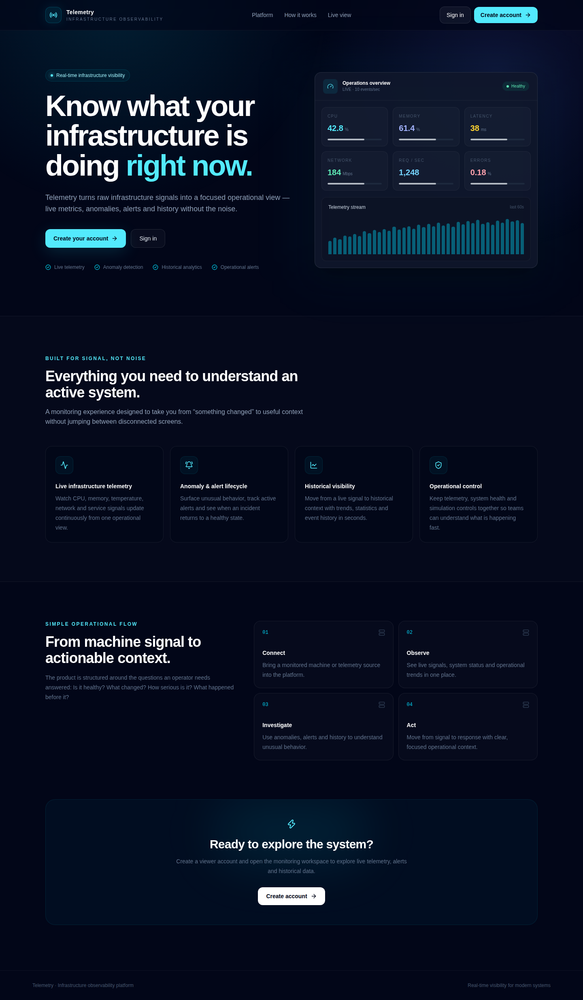

The homepage introduces the observability workflow before asking a visitor to sign in. From here, **Create account** opens `/signup` and **Sign in** opens `/login`. The authenticated product lives under `/app`.

## 2. Enter the control center

New accounts start with the **Viewer** role. After sign-up or sign-in, the frontend loads the current identity from `GET /api/auth/me`. The server—not the browser's stored profile—decides what the user can read or change.

- **Viewer** can inspect telemetry, alerts, analytics, hosts, incidents, changes, SLOs, services, and settings.
- **Operator** can also acknowledge alerts and incidents, record change events, and use simulation controls.
- **Admin** can manage users, hosts, alert rules, SLOs, agent credentials, notifications, and platform operations.

A request that crosses a role boundary is checked again by the backend.

## 3. Read live telemetry

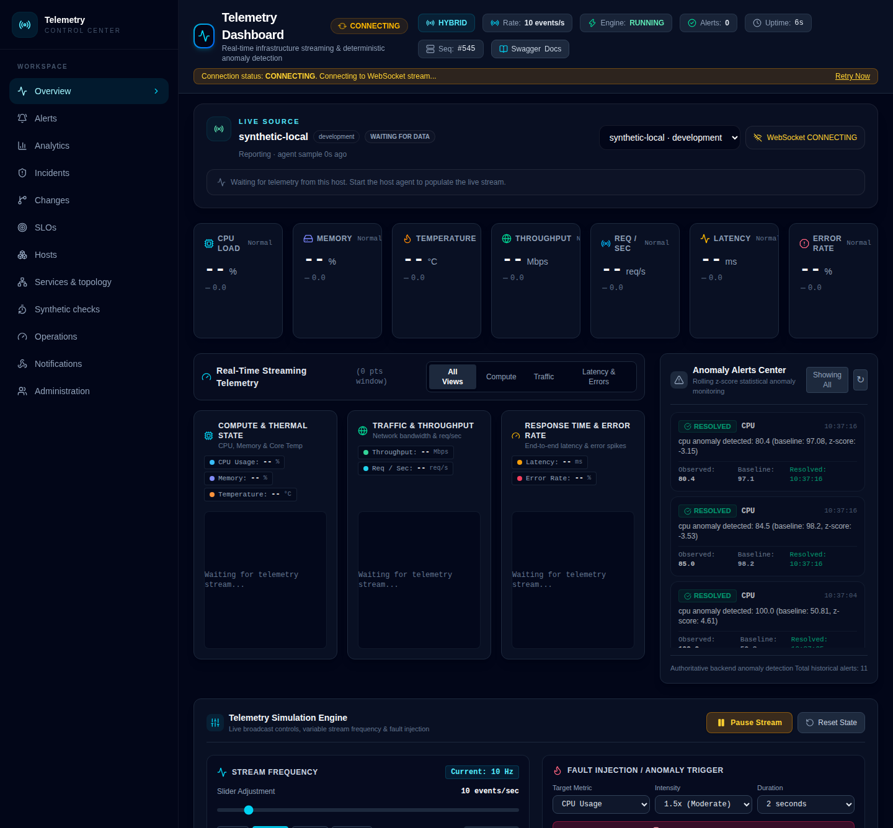

The overview puts the current signals together: CPU, memory, temperature, throughput, requests per second, latency, and error rate. The chart groups make it easier to compare compute, traffic, and latency/error behavior, while the historical table and backend-computed aggregates provide detail beyond the latest sample.

This capture shows the dashboard's **simulated** stream, which is useful for reproducing anomalies without depending on a physical host. The visible values, chart points, and resolved alert entries are runtime output—not static numbers inserted into the screenshot. The stream status also surfaces sequence gaps and offers a route into historical inspection.

Operators can pause or resume the stream, change its rate, reset simulator state, and trigger a controlled anomaly. Reset requires confirmation.

## 4. Explore persisted history and analytics

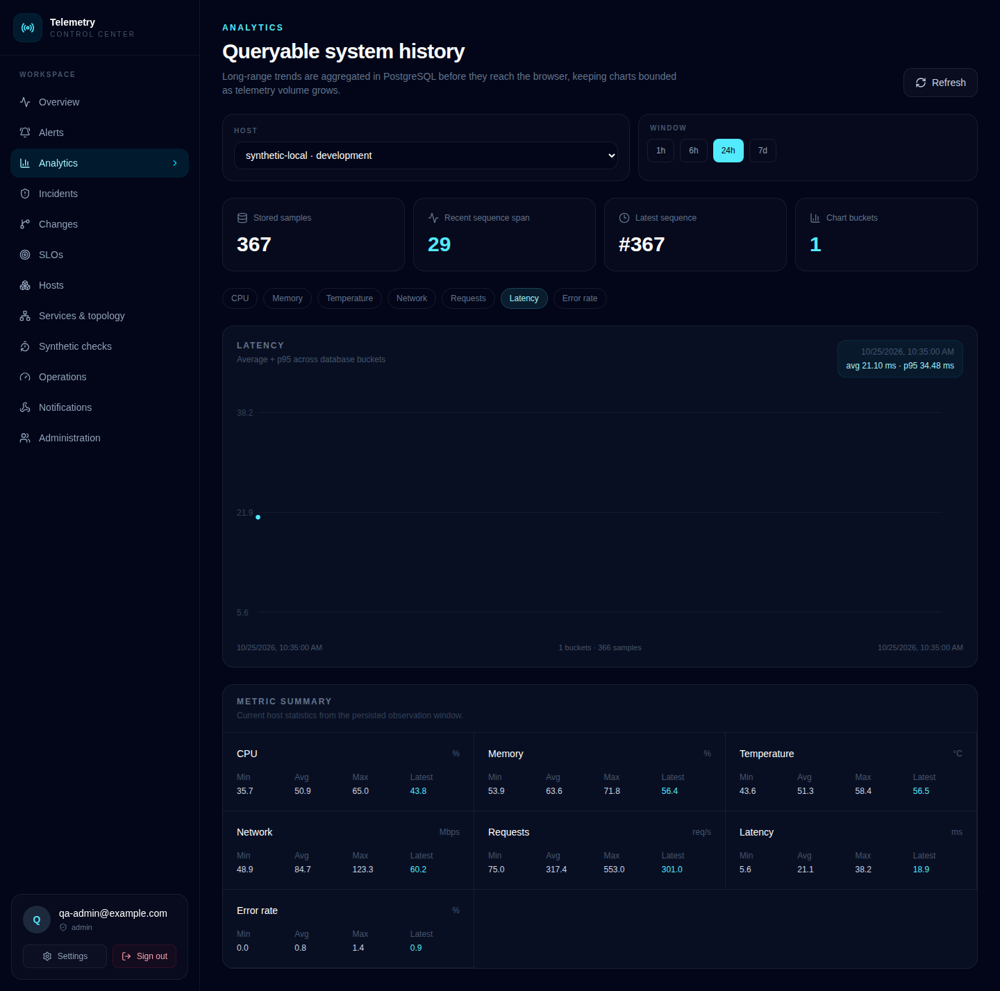

Analytics is the place to move from the live view to the evidence behind it. The page reads stored samples and backend-computed statistics, with bounded time-series history and percentile information rather than relying on an unbounded browser-side collection.

During the integrated journey, the browser read the telemetry statistics and history endpoints and confirmed that the database-backed results contained samples. This makes the historical view useful after a stream gap or a period that needs closer investigation.

## 5. Manage monitored hosts

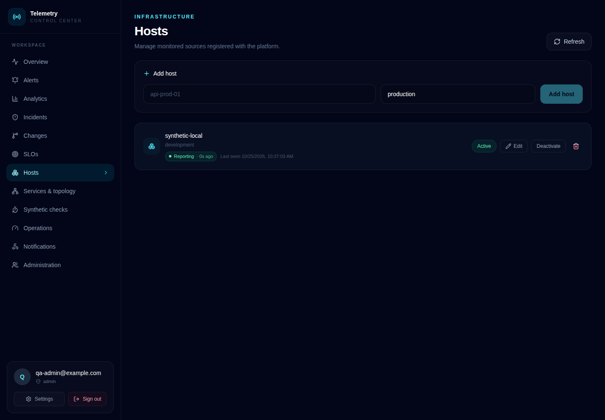

Hosts represent the monitored sources feeding the platform. The inventory shows each host's environment, active state, and last-seen/heartbeat information, and gives administrators controls to register, edit, activate, deactivate, or remove a host.

The integrated journey also exercised the host-scoped agent credential flow: an administrator created a key, submitted a telemetry batch to `POST /api/ingest/v1/telemetry`, repeated the batch to check deduplication, and queried history to read back the accepted agent sample. The plaintext key is shown only when it is created; subsequent key listings expose lifecycle metadata rather than the secret.

## 6. Follow alerts into incidents

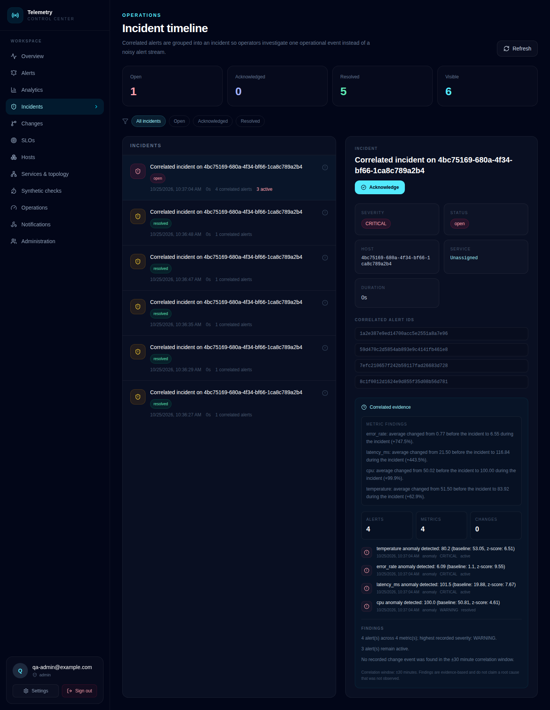

Telemetry combines statistical anomaly detection with administrator-defined alert rules. An anomaly can become an alert; related alert activity can then be grouped into an incident with acknowledgement state and an evidence timeline.

The browser journey triggered a CPU anomaly, confirmed the resulting alert through the API, acknowledged it with an authorized user, and opened the incident view. Incident evidence can correlate alert activity with nearby change events. Acknowledgement permissions are enforced by the backend, not just hidden by the UI.

## 7. See what changed

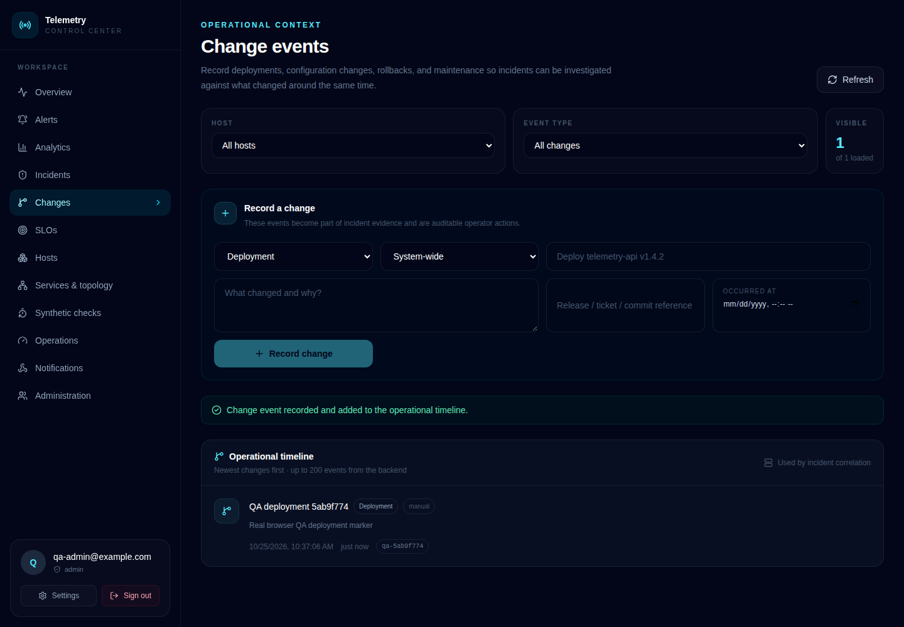

The change timeline brings deployments, configuration updates, feature-flag changes, maintenance, and rollbacks into the same investigation workflow as telemetry and alerts. Each event can carry a source and an external release, ticket, or build reference.

The integrated browser journey recorded a change event through the page and read the saved event back through the API. This gives an operator context to compare with the incident's time window instead of guessing at a root cause.

## 8. Set alert rules and service objectives

Administrators can define alert rules with a metric, comparison, threshold, sustained duration, and enable/pause state. Rules and active alert state are evaluated by the backend, so a user cannot make an alert disappear simply by changing local browser state.

The SLO workspace defines objectives for a monitored host and time window. Its status response includes sample counts, a sample-based service-level indicator (SLI), the objective, and the remaining error budget. This keeps the reliability calculation tied to persisted telemetry rather than presenting a time-weighted availability claim that the data does not support.

## 9. Deliver notifications

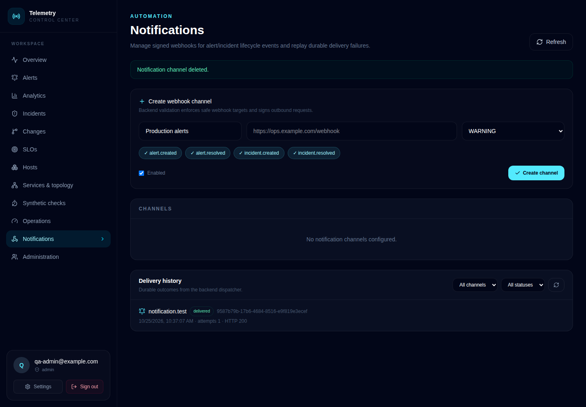

Notification channels connect alert and incident lifecycle events to an HTTP endpoint. Administrators can configure which events and severities should be delivered, send a test, and inspect the durable delivery history.

The captured delivery history includes a successful **HTTP 200** response and its attempt count. Outbound requests carry delivery and event identifiers plus an HMAC-SHA256 signature, allowing the receiving system to verify the sender and correlate retries. Failed deliveries can be inspected and replayed from the workspace.

## 10. Check HTTP endpoints synthetically

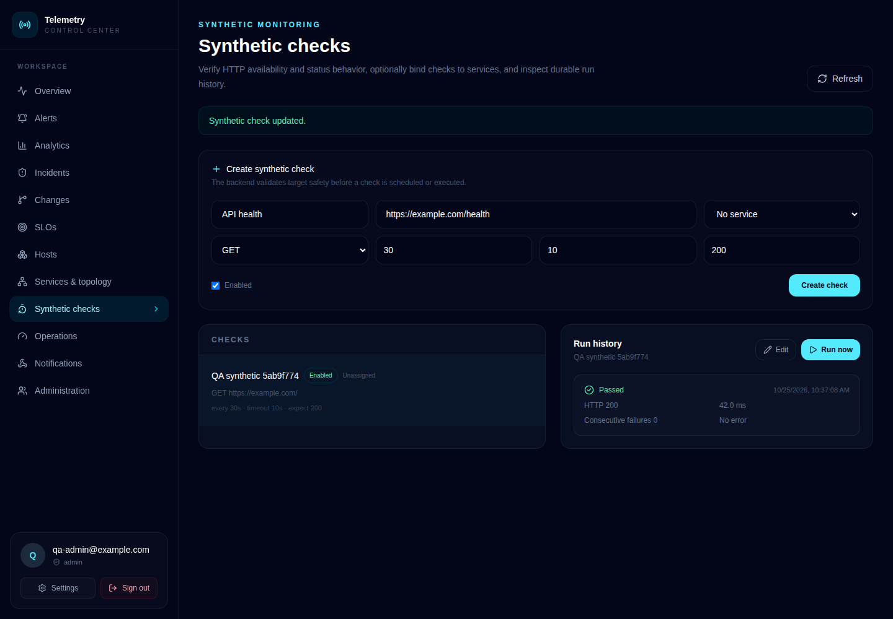

Synthetic monitoring makes a real HTTP request to a configured target and records the outcome, response time, and error details. Checks can be associated with a registered service, edited, paused, re-enabled, and run on demand.

The screenshot shows a captured run that **passed with HTTP 200 in 42.0 ms**. The integrated journey also read the run history back from the backend, so this result is not just a transient message in the browser.

## 11. Connect services and dependencies

The service registry records the services that make up an application and their dependency edges. The topology view renders these relationships so an operator can see which service depends on another while investigating a problem.

The integrated browser journey registered two services, added a dependency, read the saved edge back through the API, and opened the topology visualization. Service changes are also recorded in the audit trail.

## 12. Inspect platform operations

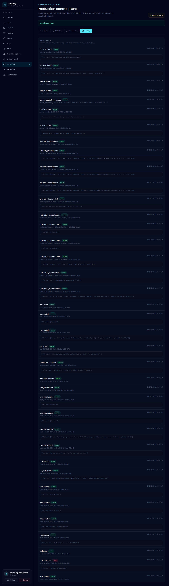

Operations brings together runtime health, pipeline pressure, alert-rule management, agent access, and the audit trail. The audit entries make sensitive control-plane actions visible after they happen.

Agent keys are scoped to a host and can be revoked. The API never returns the plaintext secret in the listing response, and the browser journey verified that revoked credentials show their updated lifecycle state. Runtime counters are also available in Prometheus exposition format for a local monitoring stack.

## 13. Administer accounts and roles

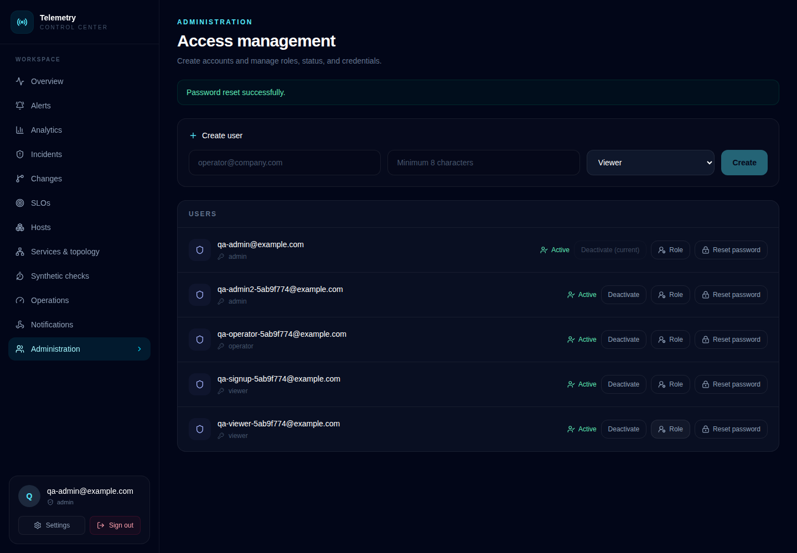

Administrators can create user accounts, assign Viewer, Operator, or Admin roles, change roles, activate or deactivate accounts, and reset passwords. The backend prevents an administrator from accidentally removing the last active administrator.

The end-to-end journey used separate role-specific sessions to check their permissions. It verified that a Viewer could not pause the simulator or create a host through direct API requests, even when those requests bypassed the visible UI controls. It also checked that deactivating an account invalidates an existing session.

## 14. Manage personal settings

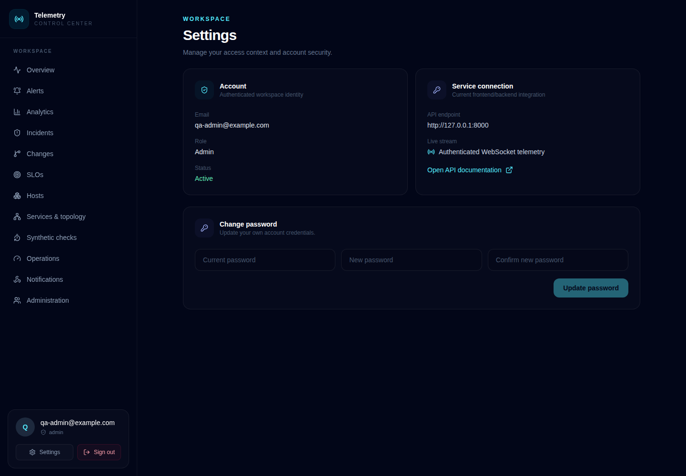

Settings provides the signed-in user with account information and password change controls. After a successful change, the browser journey signed out and signed back in with the new password, then restored the original test password for cleanup.

## 15. Use the workspace on a smaller screen

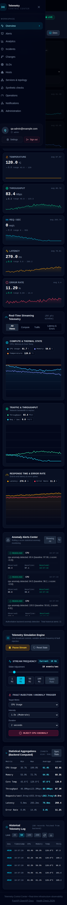

The navigation collapses for a narrow viewport and keeps the main workspace destinations available in a mobile menu. The browser journey opened this menu at a 390-pixel viewport and checked that the expected destinations remained reachable.

## How the pieces fit together

| Layer | Responsibility |
| --- | --- |
| React + TypeScript frontend | Screens, forms, charts, session handling, and live-stream presentation |
| FastAPI backend | Authentication, role enforcement, telemetry processing, anomaly detection, rules, alerts, incidents, SLO calculations, and operational APIs |
| PostgreSQL | Users, hosts, stored telemetry, alert/rule state, service relationships, SLO definitions, delivery history, and audit events |
| WebSocket | Live telemetry and lifecycle updates, using a short-lived, single-use handoff token |
| Host agent or simulator | The agent ingests host-scoped telemetry; the simulator provides a controllable stream for repeatable demonstrations |

The frontend is a control surface, not the security boundary. Protected operations and authoritative state are validated by the backend on every request.

## Continue exploring

- [Telemetry frontend repository](https://github.com/faizansaiyed123/telemetry-frontend)
- [Telemetry backend repository](https://github.com/faizansaiyed123/telemetry-backend)
- [Successful integrated browser journey used for these captures (25 October 2026)](https://github.com/faizansaiyed123/telemetry-frontend/actions/runs/40185432838)
- [Backend API and architecture documentation](https://github.com/faizansaiyed123/telemetry-backend#readme)
